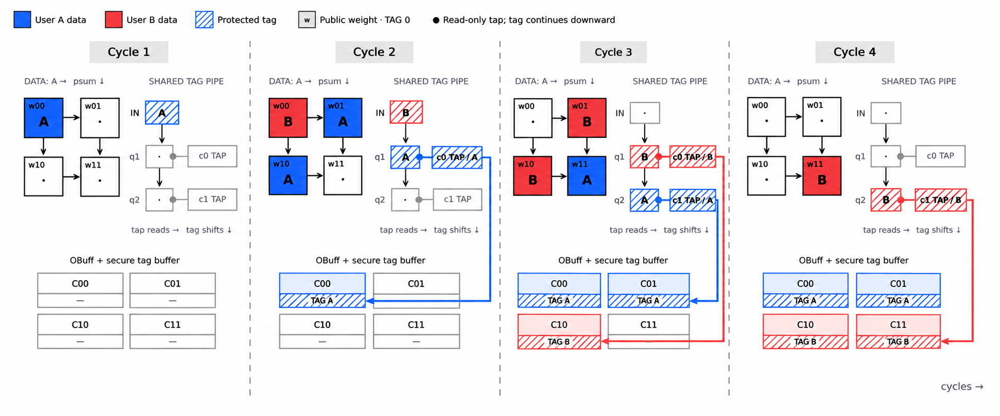

# Secure-Tagged Weight-Stationary Systolic Array

This directory contains a parameterized SystemVerilog matrix-multiplication
accelerator with a compile-time optional, 96-bit protected ownership-tag plane.
It computes signed matrix multiplication:

```text
C[m,n] = sum(A[m,k] * B[k,n])
```

The numerical design is weight-stationary: selected weights remain in PE-local
storage, activations move left-to-right, and partial sums move top-to-bottom.
The tagged build proves that each live partial sum and final result remains
associated with the trusted tag assigned to its source activation row.

> The plain and tagged builds still carry plaintext on their memory and result
> interfaces. The secure-memory build (`secure_memory_accelerator.sv`, with
> `ENABLE_SECURE_TAGS` and `ENABLE_SECURE_MEMORY`) accepts A and B only as
> authenticated AES-GCM row records and emits C only as encrypted records that
> retire after a matching storage acknowledgement. `make test-secure-memory`
> verifies that path end to end against OpenSSL. See
> [secure memory](docs/secure-memory.md) and
> [crypto implementation status](docs/crypto-primitives.md).

## What the protected tag plane does

- Trusted ingress binds one opaque 96-bit tag to every logical `A[m,*]` row.
- Public stationary weights always have implicit `TAG 0`.
- One shared tag queue advances in lockstep with the numerical compute pass.
- Each physical output column observes a read-only tap into that same queue.
- A protected OBuff tag store mirrors every numerical OBuff commit, including
  concurrent diagonal commits and retained partial sums across K passes.
- Feedback is permitted only when the retained partial tag matches the incoming
  row tag. Missing or incompatible metadata causes a sticky `security_fault`.
- Faulted work is flushed and final result export is suppressed until reset.

There are no tag registers inside every PE. The arithmetic mesh remains a
numerical data path; protected ownership travels in parallel and rejoins each
result at OBuff.

## Four-cycle 2x2 timing example

The diagram shows two users sharing one physical 2x2 array. Blue row A and red
row B carry distinct opaque tags through exactly one queue. A tap observes its
queue stage without consuming it, so the same tag can reach a later column on
the following cycle.



For an array with `ROWS = R` and `COLS = C`:

```text
queue depth        = R + C - 1
tap for column pc  = queue stage (R - 1 + pc)
```

The queue receives one row-tag packet per issued logical row; bubbles are
preserved. For the numerical schedule used here, row `m` commits at column
`pc` on compute cycle `m + R + pc`, matching the tap above. Partial final N
tiles mask inactive columns, so an inactive tap cannot write protected state.

## Trust boundary and interfaces

### Normal build

Without `ENABLE_SECURE_TAGS`, the top level preserves the ordinary numerical
host interface:

1. While idle, write dimensions with `config_we`.
2. Write every `A[m,k]` with `a_we` and every `B[k,n]` with `b_we`.
3. Pulse `start`.
4. Receive coordinates and values using `result_valid` / `result_ready`.

The disabled elaboration contains no secure tag queue, tag memory, tag checks,
or trusted tag ports.

### Tagged build

Defining `ENABLE_SECURE_TAGS` adds a trusted integration interface:

| Signal | Direction | Meaning |
| --- | --- | --- |
| `trusted_tag_we` | in | Trusted tag-binding event, simultaneous with an A write. |
| `trusted_tag_row` | in | Logical activation row being bound. |
| `trusted_tag_data[95:0]` | in | Opaque authenticated ownership/context tag. |
| `trusted_abort` | in | Trusted cancellation; flushes protected work. |
| `trusted_result_tag_valid` | out | Trusted final-result metadata is valid. |
| `trusted_result_tag[95:0]` | out | Opaque tag paired with the public numerical result. |
| `security_fault` | out | Sanitized sticky status; never reveals a tag value. |

These trusted signals must **not** be mapped into host MMIO, DMA descriptors,
debug readback, or a software-controlled register file. The tag memories are
accessible only to internal trusted scheduler, queue, policy, and egress logic.

Each accepted `config_we` starts a new ownership epoch: it erases every row tag
**and every A element's written status**, so the host must rewrite all of A
(with its tags) before the next `start`. Without this, a new owner could bind a
row with a single write and inherit the previous owner's remaining elements.
Public B elements stay valid across epochs. A configure and an A write on the
same clock edge belong to the new epoch. While `security_fault` is set, the
ready outputs are low and configure, A and B writes are ignored.

Edge cases in the tagged build:

- A `start` on the same edge as an accepted `config_we` is refused with
  `job_error`: the configure clears every A binding, so there is nothing valid
  to run.
- An A write without a simultaneous `trusted_tag_we` is ignored. Only trusted
  ingress can place activation data.
- Binding a row to a different tag within one epoch raises `security_fault`.
  A change of owner needs a new configure.
- `start` is checked against the state before its edge. An A or B write on the
  start edge does not make a refused job runnable. When the job does start, a
  same-owner A write on that edge is included in it.
- `trusted_abort` flushes all work and raises the sticky `security_fault`, even
  when idle. Only `reset` returns the accelerator to service.
- A result handshake on the same edge as `trusted_abort` or `reset` completes.
  Nothing is exported after that edge.
- `result_row`, `result_col`, `result_data` and `trusted_result_tag` read zero
  whenever `result_valid` is low. OBuff keeps partial sums and flushed results
  across abort and reset, and the port never shows them.

In every build, host writes whose coordinates exceed `MAX_M`, `MAX_K` or `MAX_N`
are ignored. The coordinate ports can encode those values, and without the range
check a synthesized buffer would truncate the address and overwrite a real row.

## Tag policy

The baseline policy is deliberately narrow:

- A first contribution starts with no OBuff tag and resolves to its row tag.
- A later contribution requires a valid stored OBuff tag equal to that row tag.
- `TAG 0` weights are public and compatible with any protected row tag.
- Different nonzero tags, a missing tag for a valid partial, an invalid commit
  tap, or an export lacking a tag all fail closed.

The RTL does not inspect fields inside a tag. It stores, compares, and propagates
the entire 96-bit value as opaque metadata.

## Directory layout

| File | Purpose |
| --- | --- |
| `weight_stationary_accelerator.sv` | Numerical controller plus tagged integration and fault handling. |
| `secure_tags.sv` | Tag policy resolver, single shared queue, and protected OBuff tag store. |
| `pe.sv`, `sysarr.sv` | Banked stationary-weight PE and generated numerical mesh. |
| `buffers.sv` | IBuff, WBuff, and numerical OBuff primitives. |
| `secure_tagging_tb.sv` | End-to-end multi-user, tiling, fault, reset, abort, and randomized regression. |
| `secure_tags_tb.sv` | Unit tests for policy resolution, queue timing, and tag-store concurrency. |
| `tenant_key_regfile.sv`, `tenant_key_regfile_tb.sv` | Trusted key provisioning, lookup, IV reservation, and adversarial unit tests. |
| `aes_primitives.sv`, `aes_key_expand.sv`, `aes_encrypt_block.sv` | Pipelined forward AES-128/256 and rolling key expansion. |
| `aes_encrypt_block_tb.sv` | Independent AES vectors, throughput, backpressure, and zeroization checks. |
| `gf128_mul.sv`, `ghash_core.sv`, `ghash_core_tb.sv` | Ordered wide GHASH primitive and independent arithmetic/NIST-vector tests. |
| `gctr_core.sv`, `gctr_core_tb.sv` | Wide pipelined counter transform, partial bytes, counter limits, and independent vectors. |
| `aes_gcm_engine.sv`, `aes_gcm_engine_tb.sv` | Bounded AES-GCM encryption/decryption, AAD framing, quarantine, and adversarial stream tests. |
| `tests/run_gcm.py`, `tests/run_gcm_negative.py` | Independent OpenSSL EVP GCM oracle and invalid-configuration checks. |
| `tenant_gcm_port.sv`, `tenant_gcm_cluster.sv` | Three trusted tenant-aware crypto paths, shared key management, fresh encryption IVs, and automatic authenticated metadata. |
| `tenant_gcm_cluster_tb.sv`, `tests/run_tenant_gcm.py`, `tests/run_tenant_gcm_negative.py` | Independent record oracle, concurrent tenants, key lifecycle/nonce races, tampering, and negative controls. |
| `weight_stationary_accelerator_tb.sv` | Original numerical end-to-end regression. |
| `authenticated_row_stager.sv`, `authenticated_row_stager_tb.sv` | Collects an authenticated row and commits it to IBuff/WBuff atomically. |
| `secure_memory_accelerator.sv` | Secure-memory top level: encrypted A/B loads, tagged compute, encrypted C stores with acknowledgement-gated retirement. |
| `secure_memory_accelerator_tb.sv`, `tests/run_secure_memory.py`, `tests/run_secure_memory_negative.py` | End-to-end OpenSSL record oracle, tampering, cancellation, storage retry, reset/abort lifecycle, and mutation controls. |
| `verilator_waivers.vlt` | Documented, narrowly scoped waivers for `make verilator-lint`. |
| `docs/shared-tag-queue-timing.png` | The shared-queue timing diagram used above. |

## Build and verification

Requires Icarus Verilog 13 or newer (the suite is verified with 13.0; the
Ubuntu-packaged 12.0 drops values on unpacked-array output ports and hangs
`run-w1`). GCM and secure-memory tests also require Python 3 and a shared
OpenSSL `libcrypto`; no third-party Python packages. `make verilator-lint`
additionally needs Verilator 5.

```sh
cd tagged_sys_arr_multi_weight_stationary

# Numerical baseline: macro disabled, no tag hardware elaborated.
make ci

# Tagged unit regression and default end-to-end secure suite.
make test-secure-tags
make tagged

# Tagged shape/weight sweep: 1x1, 1x4, 2x2 W=1/W=4, 3x5, and 4x3.
make tagged-sweep

# Key file, AES, GHASH, GCTR, and independent AES-GCM verification.
make test-crypto

# GCM-only oracle/tamper/framing suite and 4096-bit bus smoke sweep.
make test-gcm
make test-gcm-wide

# Trusted key/nonce integration and three independent crypto paths.
make test-tenant-gcm
make test-tenant-gcm-mutations

# Encrypted-record accelerator, end to end against OpenSSL.
make test-secure-memory
make test-secure-memory-mutations

# Compile-only checks for all elaborations, plus Verilator lint.
make lint
make tagged-lint
make secure-memory-lint
make verilator-lint

# Complete repository-local verification gate.
make full-ci

# Extended independent oracles, parameter/stress campaigns, and mutation checks.
# Also requires the OpenSSL CLI; no Python packages or network access.
make rigorous-ci
```

The [verification matrix](docs/verification.md) lists the per-module checks,
reproduction commands, and limits of simulation coverage.

The secure suite covers one, two, three, and per-row-distinct users; K and N
tiling; partial N tiles; resident-weight banks; full capacities; back-to-back
jobs; result backpressure; reset; trusted abort; missing tags; conflicting row
tags; and verification-only fault injection for missing feedback metadata and
invalid commit taps.

`SECURE_TAG_TEST_HOOKS` is defined only by tagged simulation targets. It adds
internal verification hooks, not production ports, for negative testing.

## Parameters

| Parameter | Meaning |
| --- | --- |
| `ROWS`, `COLS` | Physical PE-array shape. |
| `WEIGHTS_PER_PE` | Number of resident stationary-weight slots per PE. |
| `DATA_WIDTH`, `ACC_WIDTH` | Signed operand and accumulated-result widths. |
| `MAX_M`, `MAX_K`, `MAX_N` | Bounded logical matrix capacities. |
| `TAG_WIDTH` | Protected tag width; defaults to 96. |

`WEIGHTS_PER_PE` affects local weight capacity and reload frequency. It does
not change queue depth or tap positions for a single compute pass.

## Limitations and intended next integration

- Only the secure-memory build encrypts and authenticates memory transfers;
  the plain and tagged builds remain plaintext at their interfaces.
- The tenant key file is volatile. The trusted provisioner must never restart
  a retired key/IV sequence after reset or power loss (see
  [crypto implementation status](docs/crypto-primitives.md)).
- Architectural connectivity prevents ordinary software from using tags; it
  does not address physical probing, scan access, fault injection, or
  side-channel leakage.
- The trusted ports should be connected through a production trusted-ingress /
  trusted-egress wrapper before integration into a software-visible system.
- No synthesis/area comparison is included because no synthesis tool is part
  of this repository-local flow.
