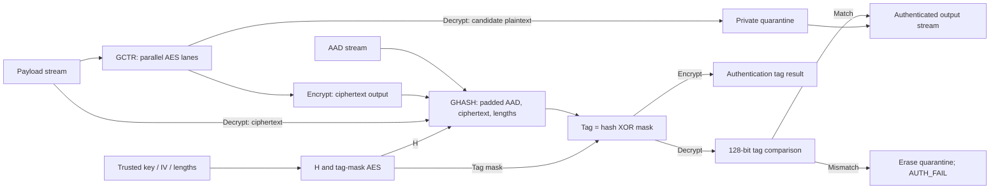
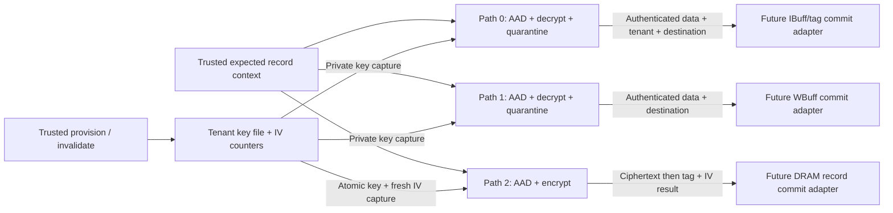

# AES-GCM implementation status

The tenant key file, forward AES pipeline, GHASH, GCTR, and AES-GCM transaction
engine are implemented. `tenant_gcm_cluster` connects three private engines to
the protected key file, encryption IV reservation, and authenticated tenant
record metadata. The accelerator still transfers plaintext: buffer/tag adapters,
committed DRAM records, and a full-secure accelerator configuration still require
integration. Crypto-subsystem tests do not complete the security specification's
end-to-end acceptance criteria.

| Specification checkpoint | Status |
| --- | --- |
| 2: Tenant key register file | Implemented and unit tested, subject to the provisioning lifecycle contract below. |
| 3: AES block cipher | AES-128 and AES-256 known-answer, pipeline, stall, and reset tests pass. |
| 4: GCTR and GHASH | Wide counter-mode transform and ordered hashing; GCM controller supplies padding and bit-length framing. |
| GCM transaction datapath | Encryption, tag verification, bounded plaintext quarantine, and streamed authenticated release. |
| Trusted tenant crypto wrapper | Shared key file, two decryptors and one encryptor, atomic key/IV capture, busy-slot protection, and automatic AAD. |
| Secure memory integration and evaluation | Accelerator buffer/tag adapters, atomic destination/record commit, and physical evaluation remain. |

## Tenant key register file

`tenant_key_regfile` defaults to eight slots, 96-bit tenant IDs, 256-bit keys,
and three combinational engine lookup ports. AES-128 is also supported. All
ports belong inside the trusted hierarchy. There is no addressable key-read
port or software provisioning adapter.

- Provisioning writes all fields together on `provision_valid && provision_ready`.
  Rejected valid requests assert `provision_error` and do not update the slot.
- Lookup exposes a key only for exactly one matching valid tenant. Missing or
  duplicate matches return zero key/slot outputs; duplicate matches assert
  `lookup_duplicate`. Lookups into an accepted provisioning/invalidation target
  are suppressed for that cycle, preventing capture of the previous key.
- Invalidation clears validity, tenant, key, and IV state on
  `invalidate_valid && invalidate_ready`.
- Accepted operations on the same slot have priority **invalidate, provision,
  IV reservation**. Operations on different slots can commit concurrently.
  Ready/grant outputs are suppressed during reset; storage clears on its edge.
- `slot_busy` blocks all mutations and IV reservation for that slot. Each engine
  holds registered busy state from key capture through completion/abort and
  zeroization. Combine the engines' busy state per slot at integration.
- The output engine must capture its lookup key and reserve its IV on the
  **same edge while the slot is idle**, then assert busy after that edge.
  Capturing the key, asserting busy, and trying to reserve later would block
  itself. A slot already used by a decryptor conservatively delays reservation;
  different slots can continue independently.

Sample `reserved_iv` only on an edge with `reserve_iv_grant`. The value is
`{iv_fixed_field, invocation_counter}` from before the edge; its counter advances
at that edge. Keeping `reserve_iv_valid` asserted grants another reservation
each eligible cycle. An aborted encryption's reservation stays consumed,
including when clear cancels a pending result. A counter of all ones asserts
`nonce_exhausted` for an otherwise eligible request and does not wrap.

Provisioning rejects duplicate valid tenant IDs, simultaneous active aliases
of the same key/fixed-field sequence, and counter rollback for a live matching
key/fixed field. These checks do not retain retired-key history. Trusted
provisioning must never reinstall a previously used key/IV sequence after
replacement, invalidation, reset, or power loss. Use a fresh key, a globally
fresh fixed field for that key, or a persistently managed counter. Changing a
fixed field and later changing it back is also a lifecycle responsibility.

`test-tenant-keys` runs one-slot/AES-128, three-slot/AES-256, and eight-slot/AES-256
cases together. Tests cover concurrent lookups, busy slots, operation collisions,
duplicate provisioning and fault-injected duplicate entries, invalid indices,
counter rollback and exhaustion, accepted-IV uniqueness, and field zeroization.
Internal testbench inspection is not a production debug interface.

## Forward AES pipeline

Compile `aes_primitives.sv`, `aes_key_expand.sv`, then `aes_encrypt_block.sv`.
Byte zero occupies bits `[127:120]`; the first key byte is also the MSB.
`aes_encrypt_block` accepts a block/key on `in_valid && in_ready`. Every block
has its own key context, including adjacent blocks with different keys.

| Property | AES-128 | AES-256 |
| --- | --- | --- |
| Encryption rounds | 10 | 14 |
| Output becomes valid after acceptance at edge E0 | After edge E10 | After edge E14 |
| Earliest consumer transfer, with ready high | Edge E11 | Edge E15 |
| Sustained input/output rate without stalls | 1 block/cycle | 1 block/cycle |

The initial register applies AddRoundKey. Each subsequent stage performs a
round and advances a four-word (AES-128) or eight-word (AES-256) rolling key
schedule. The final stage omits MixColumns and stores no key. This avoids
copying the complete expanded schedule between stages.

A valid blocked output freezes the whole pipeline and deasserts `in_ready`.
The producer must hold a pending input until accepted. Output valid/data remain
stable until consumed. Latency is fixed in advancing cycles; backpressure adds
wall-clock cycles. Synchronous reset cancels all work and clears all key/state
registers; handshakes and output data are gated immediately while reset is high.
Invalid stages are zeroized as bubbles move through. An aborting transaction
engine resets its private pipeline to erase pending work.

This first block primitive recomputes the schedule per block. Transaction-local
expanded-key caching remains an area/power optimization for the GCM engines.
AES-192 is explicitly rejected. The primitive provides no authentication by
itself, and its key port must never be connected to ordinary software.

`test-aes` checks 32 independent vectors per width, including official FIPS 197
and SP 800-38A examples, zero/all-one inputs, and varied keys/blocks generated
with OpenSSL. Embedded vectors make regression independent of Python/OpenSSL
installation. It also checks a 96-block continuous burst, randomized input
bubbles/output stalls, key changes, canceled work, recovery, and internal
zeroization. Vector provenance and reproduction details are in the testbench.

## GHASH block stream

`gf128_mul` implements the GCM field multiplication. `ghash_core` captures `H`
on `start_valid && start_ready`, then accepts ordered padded blocks on
`in_valid && in_ready`. The first data beat can arrive on the next edge.

`MEM_DATA_W` must be a positive multiple of 128. Lane zero is the most
significant 128 bits of `in_data`. `in_blocks` specifies the number of leading
blocks to hash (1 through `MEM_DATA_W / 128`); trailing lanes are ignored.
Partial lane counts are permitted on intermediate as well as final beats.
Zero/out-of-range counts abort the transaction, zeroize its state, and pulse
`protocol_error` without producing a result.

Each beat applies the ordered recurrence `(accumulator XOR block) * H` once
per valid lane through a combinational multiplier chain. It is one message
across all lanes. `in_last` registers the final hash after the accepting edge
and clears the working subkey/accumulator. `out_valid` holds the result until
`out_ready`; that handshake clears the result register and can accept the next
start on the same edge. `reset` or `clear` cancels active and pending-result work.
The hash and all intermediate state remain inside the trusted boundary.

The GCM controller must feed independently zero-padded AAD, independently
zero-padded ciphertext, and the 128-bit length block containing their two
64-bit **bit** lengths. Empty AAD/ciphertext still require a zero length block.
This primitive does not create framing or enforce byte-valid masks itself.

`test-ghash` runs widths 128, 384 (three lanes), 512, and 4096. Tests compare
official NIST GHASH intermediates for empty, AAD-only, ciphertext-only, and
partial-block messages. Randomized messages use a separate polynomial
convolution/reduction reference. Tests check lane ordering, unused lanes,
continuous beats, bubbles, output stalls, malformed counts, reset, and erasure.

All tested widths accept one beat per cycle in RTL simulation. The unrolled
multiplier chain grows with lane count; this is not a clock-frequency or
physical bandwidth result. No synthesis, area, timing, or power measurements
have been performed. The full three-engine design's throughput is unverified.

## GCTR stream

`gctr_core` captures `key_in` and `initial_counter` on its start handshake. It
replicates the existing pipelined AES core once per 128-bit memory lane. Counters
advance on accepted input only: `inc32` wraps the low 32 bits and preserves the
upper 96 bits. The engine bounds each transaction to at most `2^32 - 2` blocks,
including the partially used final block. GCM payload counters start at
`{IV, 32'd2}`; `{IV, 32'd1}` is reserved for the tag mask.

`MEM_DATA_W` is a positive multiple of 128. Byte zero and its keep bit are the
MSBs. Intermediate beats must have every keep bit set. The final beat must have
a nonempty contiguous prefix of keep bits set. Invalid keep masks or a block
limit violation abort accepted work, clear all state, and pulse `protocol_error`.
Only valid bytes are stored and emitted; disabled output bytes are zero. A
malformed offered beat is accepted to abort even while output is stalled; this
cancels the pending output and does not wait for downstream readiness.

Payload, keep, and last metadata advance with the AES pipeline and freeze under
output backpressure. With no stalls, the first output appears after the same
10/14 advancing round cycles as the AES primitive, then one beat can transfer
per cycle. The next transaction starts after the final output transfer. Reset
or `clear` cancels active or stalled work without returning an output.

## AES-GCM transaction engine

`aes_gcm_engine` combines the primitives with one active transaction at a time.
It accepts AES-128 or AES-256, 96-bit IVs, and full 128-bit authentication tags.
The default payload and AAD limits are 4096 bytes each. `MAX_TXN_BYTES` must be
positive; `MAX_AAD_BYTES` may be zero. Neither limit needs to align to a beat.
Both encrypt and decrypt commands are bounded by these limits, so the bounded
32-bit length interface cannot approach GCM's payload counter limit.

Compile in this order:

```text
aes_primitives.sv aes_key_expand.sv aes_encrypt_block.sv
gf128_mul.sv ghash_core.sv gctr_core.sv aes_gcm_engine.sv
```

The command transfers on `start_valid && start_ready` and captures `decrypt`,
`key_in`, `iv`, `expected_tag`, `aad_bytes`, and `payload_bytes`. These are
**trusted internal ports**. The caller must obtain the key through protected
tenant lookup and reserve a fresh IV before accepting an encryption command.
The standalone engine cannot enforce uniqueness across calls, resets, or other
engine instances. Repeated IVs used by known-answer tests are test fixtures.

Supply AAD first on the `aad_*` stream, then payload on the `in_*` stream. Each
stream's keep/last values must match its declared length exactly: full
intermediate beats, the precise final byte prefix, and last on the final beat.
An empty section has no beat. Out-of-phase inputs are backpressured; a producer
may present them early but must hold them until accepted. Once the declared
final beat has transferred, extra beats are never accepted. Missing beats wait
for the producer or trusted cancellation; the engine has no timeout policy.
A malformed payload beat is accepted as an abort even under output backpressure.
On abort, pending output valid may drop; ordinary legal transfers remain stable
through stalls.

AAD and ciphertext are padded independently to 128-bit boundaries. Dirty
disabled bytes are ignored. The controller appends the two original 64-bit bit
lengths even for empty messages. It derives `H = AES_K(0)` and the tag mask
`AES_K({IV,1})` in a separate setup pipeline before starting the streams.



During encryption, ciphertext transfers and GHASH updates occur together. The
success result appears only after the final ciphertext is consumed and the
authentication tag is calculated. The caller must keep the DRAM record
uncommitted until it has stored both the tag and ciphertext successfully.

During decryption, candidate plaintext remains in a private
`ceil(MAX_TXN_BYTES / MEM_BYTES)`-beat quarantine. `out_valid` stays low and all
public output data stays zero until the complete tag matches. Failed decryption
erases the quarantine and emits no plaintext. Successful decryption releases
the stored beats in order, respecting stalls and erasing each consumed entry.
The success result follows the final authenticated output transfer. This is
authentication-before-release; the future buffer adapter must still provide
atomic destination-data and tenant-tag commit, including abort during release.

```mermaid
sequenceDiagram
    participant C as Trusted command
    participant E as GCM engine
    participant Q as Private quarantine
    participant B as Destination adapter
    C->>E: Capture key, IV, lengths, expected tag
    Note over E: Derive H and tag mask
    C->>E: AAD then ciphertext (ready/valid)
    E->>Q: Candidate plaintext, no public output
    Note over E,Q: Hash length block; compare full tag
    alt Tag matches
        Q->>B: Authenticated beats (ready/valid)
        Note over Q,B: Erase each consumed beat
        E->>C: Held success result after final beat
    else Tag mismatch
        Note over E,Q: Erase all candidate plaintext and crypto state
        E->>C: Held AUTH_FAIL result, no plaintext
    end
```

| `result_error` | Meaning |
| --- | --- |
| 0 | Success; `result_tag` contains the tag for encryption and zero for decryption. |
| 1 | Authentication failed; no plaintext is released. |
| 2 | An accepted beat has invalid framing, or a child primitive reports an error. |
| 3 | Command payload or AAD length exceeds the configured capacity. |

`result_valid`, tag, and error remain stable until `result_ready`. Every failure
returns a zero tag; calculated decryption tags are never exposed. A cleanup
cycle clears private pipelines before terminal status becomes visible. A new
command is accepted after status consumption. Reset or trusted `clear`
immediately suppresses all handshakes/data and synchronously wipes registers,
pipelines, and the entire quarantine; canceled commands produce no result.

The datapath has one AES lane per memory lane and can accept a payload beat per
cycle once streaming starts, absent backpressure. Setup, section transitions,
finalization, status, and decryption replay add transaction overhead. Quarantine
storage has explicit parallel erasure and is expressed as registers; block-RAM
mapping is not promised. GHASH still has a width-dependent combinational chain.
Expanded-key caching, area optimization, synthesis, and clock timing remain
unmeasured. This is not a claim of end-to-end DRAM throughput.

## Trusted tenant crypto cluster

`tenant_gcm_cluster` is the trusted key/nonce boundary for three independent
`tenant_gcm_port` instances. Each port owns a private `aes_gcm_engine`:

| Path index | Direction | Intended adapter |
| --- | --- | --- |
| 0 | Authenticated decryption | Activation/IBuff load |
| 1 | Authenticated decryption | Weight/WBuff load |
| 2 | Authenticated encryption | OBuff store |

The public cluster interface exposes trusted write-only key provisioning and
invalidation, trusted commands, payload streams, and held results. It exposes
no key lookup output, raw key selector, or raw AAD stream. These ports must stay
inside the trusted hierarchy. In particular, `cmd_tenant_id`, `cmd_record_type`,
and `cmd_destination` describe the scheduler's **expected** context, never
ownership or routing fields accepted blindly from DRAM or ordinary software.

The command captures tenant, record type, logical destination, and payload byte
length on `cmd_valid[p] && cmd_ready[p]`. Decryptors additionally capture the
record's IV and expected authentication tag. The encryptor ignores `cmd_iv[2]`
and `cmd_expected_tag[2]`: its key and newly reserved IV come from the key file
on that same accepting edge. It never samples a key first and reserves an IV
later. The IV counter increments exactly once at acceptance and is never rolled
back by an abort, authentication/framing failure, or a canceled result.

Each port builds exactly 32 bytes of AAD, serialized most-significant byte first
with big-endian integer fields. Memory width affects beat packing only:

| Byte offsets | Field |
| --- | --- |
| 0–3 | Format/domain magic `0x54474331` (`TGC1`) |
| 4–15 | 96-bit trusted tenant ID |
| 16–19 | 32-bit expected logical record type |
| 20–23 | 32-bit payload byte length |
| 24–31 | 64-bit expected logical destination |

Record type and destination are opaque logical identifiers chosen by the
trusted record policy. Their interpretation must match on encryption and
decryption. Record type is not forced to equal the physical path index, so an
output record can later be loaded when its trusted expected context matches.
This binding detects record substitution across those contexts, including
tenants with equal AES keys. It does not establish freshness: replay of an old
valid record with the same expected context still requires a separate policy.



Key ownership is registered per port and ORed per slot. Two or three ports may
capture one idle slot together, and one port finishing does not release another
port's ownership. A slot stays busy through a held result and until its final
owner acknowledges that result or reaches a synchronous clear edge. Provision
and invalidate therefore cannot change a key on a clearing edge before private
state is erased. Reset also destroys the key file, so the provisioning lifecycle
contract above still applies.

The existing key file conservatively reserves IVs only while the slot is idle.
An output command using a busy slot waits; it cannot consume an IV while it is
waiting. New decrypt commands targeting that same busy slot are backpressured
while the output command waits, allowing existing owners to drain. Decryptors
using other keys continue, and all three paths may start together once the slot
is idle. The fairness rule cannot force progress if a client indefinitely holds
an earlier result or withholds required payload/output readiness.

Accepted provisioning/invalidation has priority over new commands: all command
handshakes pause for that edge, avoiding a transient suppressed lookup becoming
a false missing-key response. Already-active crypto streams continue. Rejected
key updates do not pause unrelated commands.

```mermaid
sequenceDiagram
    participant S as Trusted scheduler
    participant K as Shared key file
    participant P as Private encrypt port
    S->>P: Present expected context; hold command until ready
    Note over K,P: Slot idle; unique key match; IV available
    par Same accepting clock edge
        K->>K: Reserve IV; increment counter
        K->>P: Capture key and reserved IV in GCM engine
        P->>P: Register slot ownership and record metadata
    end
    Note over K,P: Slot busy; provisioning/invalidation blocked
    P->>P: Emit AAD internally; encrypt payload
    alt Completion
        P->>S: Hold tag + reserved IV + success
        S->>P: Accept result
        P->>P: Clear result and release slot ownership
    else Trusted clear
        Note over P: Suppress public handshakes immediately
        P->>P: Wipe private state on clock edge; release ownership
        Note over K: Reserved IV stays consumed
    end
```

Cluster results use four-bit errors. Codes 0–3 retain the GCM meanings above;
4 is a missing key, 5 is a duplicate key match, and 6 is nonce exhaustion.
Command rejection priority is oversized length, duplicate, missing, then nonce
exhaustion. Rejected commands capture no key, take no slot ownership, consume
no payload, and reserve no IV. Results remain stable until acknowledged.

Only a successful encryption result returns a nonzero-capable `result_tag` and
`result_iv`; decrypt and failure results return zero in those fields. Encryption
ciphertext is tentative until the destination adapter stores the complete
record and commits it. Decryption output includes the captured trusted tenant
and destination on each valid beat. Data, keep, last, and both metadata outputs
are zero when invalid and stable under ordinary output stalls. `clear[p]`
cancels only path `p`, including a held result, while preserving other paths and
the key file's advanced IV counters.

The cluster does **not** write IBuff/WBuff/OBuff or expose compute-valid bits.
The next adapter must stage these authenticated bytes and atomically commit the
whole destination range with its tenant tags only on successful completion.
An abort halfway through a successful authenticated output stream must still
discard that adapter's partial transaction. Similarly, OBuff retirement must
wait for external record commit, not merely ciphertext ready/valid handshakes.

## Next integration work

1. Define encrypted DRAM record framing and connect trusted accelerator command
   contexts to the cluster's fixed authenticated record metadata.
2. Add authenticated atomic commit for IBuff plus tenant tags and WBuff using
   the two decrypt paths; handle abort during destination staging.
3. Connect OBuff data/ownership to the encrypt path and committed ciphertext
   records; retire data and metadata together after storage acknowledgment.
4. Verify interrupted records/commits and concurrent tenants through the whole
   accelerator, including reset/fault isolation and sustained bandwidth;
   synthesize baseline, tag-only, and full-secure configurations for evaluation.

## Sources

- [NIST FIPS 197](https://nvlpubs.nist.gov/nistpubs/FIPS/NIST.FIPS.197-upd1.pdf): AES transformations and key expansion.
- [NIST SP 800-38A](https://nvlpubs.nist.gov/nistpubs/Legacy/SP/nistspecialpublication800-38a.pdf): AES known-answer blocks.
- [NIST SP 800-38D](https://nvlpubs.nist.gov/nistpubs/Legacy/SP/nistspecialpublication800-38d.pdf): GCM field multiplication and GHASH.
- [NIST GCM example values](https://csrc.nist.gov/CSRC/media/Projects/Cryptographic-Standards-and-Guidelines/documents/examples/AES_GCM.pdf): independent GHASH intermediates, including partial AAD/ciphertext.
