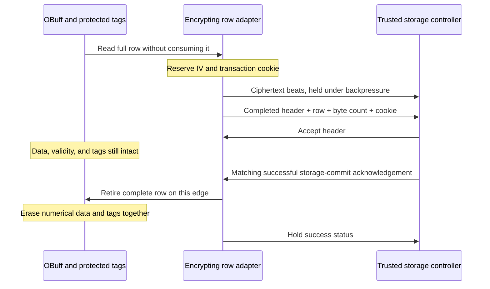

# Encrypted row records and atomic accelerator commits

`secure_memory_accelerator` connects the tenant GCM cluster to the tagged
weight-stationary accelerator. Its memory-facing data is ciphertext. Activation
rows and public weight rows enter through separate authenticated streams;
result rows leave through encryption and an explicit storage acknowledgement.
The numerical and tag-only top levels remain available separately.

Build this top with **both** `ENABLE_SECURE_TAGS` and `ENABLE_SECURE_MEMORY`.
The memory build disables the core's scalar A/B writes and replaces ordinary
result handshakes with non-destructive reads and complete-row retirement.
There is no software-visible plaintext or protected ownership-tag port on the
wrapper. Provisioning, configuration, expected tenant/row context, cancellation,
and storage acknowledgements belong to trusted internal controllers.

```mermaid
flowchart LR
    A["Encrypted activation row"] --> DA["Tenant decryptor 0"]
    B["Encrypted public-weight row"] --> DB["Tenant decryptor 1"]
    DA --> SA["Private row staging"]
    DB --> SB["Private row staging"]
    SA -->|"One edge: full row + tenant + validity"| IA["IBuff / protected row tags"]
    SB -->|"One edge: full row + validity"| WB["WBuff"]
    IA --> C["Tagged systolic computation"]
    WB --> C
    C --> O["OBuff / protected result tags"]
    O -->|"Read without retirement"| E["Tenant encryptor 2"]
    E --> D["Tentative ciphertext + record header"]
    D --> S["Trusted storage controller"]
    S -->|"Matching successful commit acknowledgement"| R["Erase row data + tags; advance"]
    R --> O
```



## Record representation

Each physical DRAM record has a 32-byte header followed immediately by its
ciphertext payload. All byte streams and integer fields are most-significant
byte first. The trusted controller determines the physical record address;
the accelerator authenticates its expected logical context.

| Byte offsets | Field |
| --- | --- |
| 0–3 | Format magic `0x54475231` (`TGR1`) |
| 4–15 | 96-bit GCM IV |
| 16–31 | 128-bit authentication tag |
| 32 onward | Ciphertext, with exactly the trusted configured payload length |

The wrapper receives the header on `load_header` and ciphertext on `load_data`.
A DMA or testbench model reads these two regions of the same record. On export,
ciphertext transfers first and the completed header follows on its own channel;
the storage controller writes the header at offset zero and ciphertext at
offset 32, then publishes the record atomically. This interface is a bounded
record protocol, not a DDR PHY or AXI implementation.

The tenant cluster constructs the existing 32-byte `TGC1` authenticated header
internally. Its record fields are fixed by this wrapper:

| Path | AAD record type | Expected tenant | Logical destination | Payload bytes |
| --- | --- | --- | --- | --- |
| Activation load, index 0 | 1 | Trusted `load_tenant[0]` | Activation row index | `K * DATA_WIDTH / 8` |
| Public weight load, index 1 | 2 | Zero | Weight row index | `N * DATA_WIDTH / 8` |
| Result export, index 2 | 3 | Protected OBuff row tenant | Result row index | `N * ACC_WIDTH / 8` |

Tenant zero has its own provisioned authentication key for public weight
records. A nonzero weight tenant is rejected: the compute policy treats all
weights as public `TAG 0`. Source IVs and tags are untrusted record fields;
source tenant, destination, type, and length come from trusted control or
protected state. Every output word's protected tag must agree with the captured
row tenant before that word enters encryption.

Shape and row limits are checked before a load starts. Integer elements are
two's-complement values packed in big-endian byte order. `DATA_WIDTH` and
`ACC_WIDTH` must be positive whole-byte widths, and `ACC_WIDTH` must divide
`MEM_DATA_W`. The crypto bus is a positive multiple of 128 bits. A final keep
mask contains precisely the leading valid bytes; unused output bytes are zero.

## Atomic ingress and configuration epochs

`load_valid[p] && load_ready[p]` captures one command on each input path. The
producer holds pending ciphertext beats until `load_data_ready[p]`; header
fields and command pins may change after command acceptance. Paths 0 and 1 can
load independently while computation is idle.

GCM first quarantines candidate plaintext until the whole tag verifies. The
`authenticated_row_stager` then collects the authenticated stream privately.
It checks every byte mask, last marker, byte count, tenant, and destination.
Only a successful held GCM result with a complete staged row can assert the
core's row-commit signal. The core copies all active words, publishes validity,
and binds the activation tenant on that **same clock edge**; unused tail words
are erased. The GCM result is acknowledged on that edge, so its key slot stays
owned until atomic publication. A held load status does not permit another
command on that path.

```mermaid
sequenceDiagram
    participant D as DRAM record reader
    participant G as GCM decryptor
    participant S as Private row stager
    participant B as Core buffer and metadata
    D->>G: Expected context + IV/tag; ciphertext beats
    Note over G: Authenticate complete record in quarantine
    G->>S: Authenticated plaintext beats
    Note over B: Previous complete row remains unchanged
    G->>S: Hold successful terminal status and key ownership
    Note over S,B: One accepting edge
    S->>B: Publish complete row + validity + tenant
    S->>G: Acknowledge terminal status
    Note over S: Erase private row and context
    S->>D: Hold load success until accepted
```

Authentication or framing failure leaves the prior committed destination row
unchanged. `clear[0]` or `clear[1]` discards that path's pending work, including
partially staged plaintext, without affecting the other path or previously
committed rows. A failed replacement can therefore leave an older complete row
usable; trusted scheduling decides whether to compute with that row or retry.

An accepted configuration begins a fresh allocation epoch: it erases both
input buffers and every input-valid and row-tag bit. Old weights or partly
rewritten rows cannot satisfy a new job. Configuration and compute start wait
until all load commands/statuses have drained. Configuration takes priority
over simultaneous start/load requests. `config_error` reports rejected shapes;
`job_error` reports a start with invalid dimensions or missing committed inputs.

## Output storage, retry, and retirement

The wrapper reads an OBuff row without advancing the core's output position.
It derives the encryption tenant from protected result tags, reserves a fresh
IV through the key file, and serializes the signed result words into GCM.
Ciphertext on `store_*` is tentative. Its `store_row`, `store_bytes`, and
`store_cookie` identify the active record; these fields also accompany the
held header and remain available while an acknowledgement is pending.

After every ciphertext byte has transferred, `store_header_valid` offers the
complete `TGR1` header until `store_header_ready`. The controller must then
finish storing and atomically publishing the record before acknowledging it.
`store_ack_valid && store_ack_ready` consumes an acknowledgement; only an
**equal cookie and successful acknowledgement** retires the current row.
Wrong-cookie acknowledgements are discarded while the current request remains
pending. An acknowledgement cannot retire anything before the header handshake.



A matching failure acknowledgement reports error 8 and preserves the OBuff
row. Once `store_result_ready` accepts that status, encryption retries the same
row with a **new IV and cookie**. Clearing path 2 also preserves the row and
burns any accepted reservation; retry resumes after clear is removed. The
controller must discard tentative writes from the canceled attempt. Delayed
acknowledgements from that attempt cannot retire a later attempt because their
cookies differ. Source data/tag retirement never follows plaintext acceptance,
ciphertext acceptance, or header acceptance alone. `done` pulses only when the
last result row has received its successful storage acknowledgement.

## Cancellation, erasure, and status

`abort` discards the entire job, configuration, staged rows, numerical buffers,
PE state, and protected tags. It preserves key provisioning, advanced nonce
counters, and the next storage cookie. A fresh configuration and complete input
loads are required afterward. A core security fault blocks all traffic and
cancels private crypto work until trusted abort or reset recovers the core.

Global `reset` also destroys the key file and resets storage cookies. **The
trusted storage controller must discard or drain all pre-reset requests and
acknowledgements before starting the new reset epoch.** An old acknowledgement
cannot be distinguished by cookie alone after reset. Fresh keys do not replace
this storage-protocol requirement. Reprovisioning must additionally follow the
[key/IV lifecycle contract](crypto-primitives.md#tenant-key-register-file).

| Error | Meaning |
| --- | --- |
| 0 | Successful atomic load or acknowledged output record |
| 1–6 | GCM authentication/framing/length or tenant key/nonce error, as defined by the cluster |
| 7 | Invalid expected row/header/public-weight context or internal stream/provenance mismatch |
| 8 | Storage rejected the output record; row remains available for retry |
| 9 | Storage cookie space exhausted; no cookie wrap or new output command |

Cookies advance on accepted encryption commands and never rewind on clear or
abort. The default width is 64 bits. Status/data/metadata are zero when their
associated valid signal is inactive, except record routing fields remain valid
while `store_ack_ready` identifies a pending acknowledgement. No calculated
decryption tags are exposed.

## Verification and implementation limits

```sh
make test-row-stager
make test-secure-memory
make test-secure-memory-negative
make test-secure-memory-mutations
make secure-memory-lint

python3 tests/run_secure_memory.py --keys 128 --widths 128 --quick
```

The integration oracle combines Python signed matrix multiplication with
OpenSSL EVP encryption/decryption and known NIST self-checks. Simulation models
the DRAM record store and its commit acknowledgement; the synthesizable DUT
contains the crypto, atomic staging, tagged computation, and retirement logic.
See [verification results](verification.md) for tested configurations and limits.

This implementation uses register arrays, wide atomic row writes, and parallel
erasure. No SRAM inference, frequency, area, power, or physical side-channel
claim is made. Record authentication binds context but does not supply replay
freshness: an old valid record with the same expected context still needs a
separate trusted version/freshness policy. An external controller remains
responsible for actual physical storage atomicity and reset-epoch draining.
